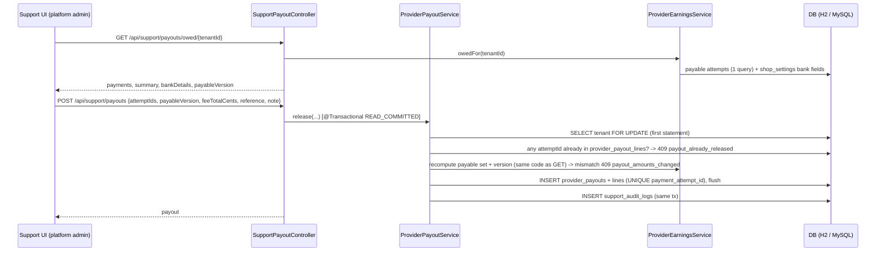

# Plan: Provider payouts, platform commission and 7-day date defaults

| Field | Value |
|-------|-------|
| Requirements | `docs/engineering/requirements/provider-payouts.md` (source of truth; AC-1..AC-20) |
| Branch | `feature/provider-payouts` |
| Size | M |
| ADRs | [0001 payout ledger and double-release prevention](../adr/0001-provider-payout-ledger-and-double-release-prevention.md), [0002 Paystack fee capture on the payment attempt](../adr/0002-paystack-fee-capture-on-payment-attempt.md) |
| CTO approval needed | None for the architecture: new tables in the existing datastore, no new dependency, no breaking contract. One business confirmation is open, see Risk R1 (pre-ledger payments). |

## Architecture

### 1. Size and limits
- Everything stays in the existing modular monolith. There are no new dependencies, datastores or async jobs, and **no Paystack Transfers call** (BR-7).
- Schema changes come from JPA entities under `ddl-auto=update`: 3 new tables, 1 new nullable column and 1 new index. All are additive. Hibernate creates them on H2 and MySQL. `DatabaseSchemaUpkeep` (config/DatabaseSchemaUpkeep.java:18-28) does **not** change, because it only exists for NOT NULL columns that need a non-default backfill.
- Money is integer cents (`long`) end to end. The commission rate is integer **basis points** (12.5% = 1250 bp), so there is no BigDecimal or double in any amount (NFR-1). The UI does conversions with string or integer helpers.
- Commission base: **gross** payment amount, rounded half-up per payment (CTO confirmed). One method computes it (section 5). It is not configurable.
- Out of scope (from the requirements follow-ups): clawback, bulk release, CSV, Transfers API, bank-detail snapshot and payout notifications.

### 2. Approach

New backend units (package layout as today):

| Unit | Responsibility |
|---|---|
| `entities/PlatformCommissionEntity` + `repositories/PlatformCommissionRepository` | Single-row commission setting. Follows `PlatformHelpContactEntity`/`PlatformHelpContactService.ensure()` (services/PlatformHelpContactService.java:37-47), but the row has a **fixed id** so that two concurrent bootstraps cannot create two rows. |
| `services/PlatformCommissionService` | get/set the bp value, plus validation. |
| `entities/ProviderPayoutEntity`, `entities/ProviderPayoutLineEntity` + repositories | The payout ledger (ADR-0001). |
| `services/ProviderEarningsService` | **The single owed calculation** (section 5). Read-only. Used by the support Payouts page, the release screen, the release itself and the owner's My income. |
| `services/ProviderPayoutService` | Release (write path), payout history and payout detail. |
| `controllers/SupportPayoutController` (`/api/support`) | Platform-admin endpoints. Every method starts with `access.requirePlatformAdmin(principal)` (services/SupportAccessService.java:33-38). This is a new controller so that `SupportOpsController` does not keep growing. |
| `controllers/AdminEarningsController` (`/api/m/{merchantSlug}/admin`) | Owner `store-earnings` endpoint. Uses `tenantAccess.requireTenantBySlug` + `access.requireOwner` (services/MerchantAccessService.java:84), the same as the owner-only actions in controllers/AdminTeamController.java:57-58. |

Changed backend units: `PaystackClient.Transaction`, `PaystackPaymentService.toConfirmed`, `OnlinePaymentSettlementService.ConfirmedPayment`/`markOutcome` (fee capture, ADR-0002), `OnlinePaymentAttemptEntity` (+`fee_cents`, +index), `OnlinePaymentAttemptRepository` (+payable queries), `TenantRepository` (+`lockById`), `SitDangerZoneService`.

### 3. Data model
**`online_payment_attempts`** (existing, entities/OnlinePaymentAttemptEntity.java)
- `+ fee_cents BIGINT NULL`: the Paystack fee the provider bears. NULL means unknown (BR-5, A2). It is written once, when the attempt becomes PAID (ADR-0002).
- `+ INDEX idx_online_payment_attempts_tenant_outcome (tenant_id, outcome)`: serves the per-merchant owed query and the owner's range query. The global owed query uses the existing `idx_online_payment_attempts_due` (leading `outcome`, line 33).

**`platform_commission_settings`** (new, kept by the test reset)
| column | type | notes |
|---|---|---|
| id | UUID PK | fixed constant `00000000-0000-0000-0000-00000000c0de`; the service reads and creates by this id |
| commission_basis_points | INT NOT NULL default 0 | 0..5000 |
| updated_at | TIMESTAMP NOT NULL | |
| updated_by_user_id | UUID NULL | |

**`provider_payouts`** (new)
| column | type | notes |
|---|---|---|
| id | UUID PK | |
| tenant_id | UUID NOT NULL | merchant |
| payment_count | INT NOT NULL | |
| gross_cents | BIGINT NOT NULL | sum of line gross |
| captured_fee_cents | BIGINT NOT NULL | sum of known line fees |
| unknown_fee_count | INT NOT NULL | lines with NULL fee |
| fee_cents | BIGINT NOT NULL | fee total **used** (captured or admin-adjusted) |
| fee_adjusted | BOOLEAN NOT NULL | `fee_cents != captured_fee_cents` |
| commission_basis_points | INT NOT NULL | snapshot (BR-4) |
| commission_cents | BIGINT NOT NULL | sum of line commission |
| net_cents | BIGINT NOT NULL | |
| reference | VARCHAR(100) NOT NULL | trimmed, non-blank (A3; not unique) |
| note | VARCHAR(500) NULL | admin-internal, never sent to owners |
| released_by_user_id | UUID NOT NULL | |
| released_by_email | VARCHAR(320) NOT NULL | |
| released_at | TIMESTAMP NOT NULL | |

Constraints: Hibernate `@Check`: `fee_cents >= 0 AND net_cents > 0 AND net_cents = gross_cents - fee_cents - commission_cents` (H2 and MySQL 8.0.16+ enforce it). Indexes: `idx_provider_payouts_released (released_at)`, `idx_provider_payouts_tenant_released (tenant_id, released_at)`.

**`provider_payout_lines`** (new): one row per covered payment.
| column | type | notes |
|---|---|---|
| id | UUID PK | |
| payout_id | UUID NOT NULL | index `idx_provider_payout_lines_payout` |
| payment_attempt_id | UUID NOT NULL | **`UNIQUE uk_provider_payout_lines_attempt`**, the DB guarantee for BR-6 / NFR-2 |
| tenant_id | UUID NOT NULL | |
| kind | VARCHAR(16) NOT NULL | ORDER / BOOKING |
| record_id | UUID NOT NULL | order or booking id |
| payment_reference | VARCHAR(64) NOT NULL | Paystack reference (attempt.reference) |
| paid_at | TIMESTAMP NOT NULL | attempt.outcome_at |
| gross_cents | BIGINT NOT NULL | attempt.amount_cents |
| fee_cents | BIGINT NULL | captured fee snapshot (NULL = unknown) |
| commission_cents | BIGINT NOT NULL | per-payment rounded commission |

There are no DB foreign keys, which matches the project convention: entities hold raw UUID columns and nothing uses `@ManyToOne`. Integrity comes from the unique key plus the service. Retention (NFR-6): no endpoint deletes or updates payouts or lines. Only the test reset deletes them.

### 4. API contract
All money is integer **cents**. Percentages are strings with 2 decimals (`"12.50"`), together with `commissionBasisPoints`. Errors use the existing shape `{ "error": "<code>" }`: `IllegalArgumentException` gives 400 (403 for `forbidden`, 404 for `not_found`) and `IllegalStateException` gives **409** (controllers/ApiExceptionHandler.java:44-59). A request without authentication gets **401** from the security entry point (services/SecurityConfig.java:35). A merchant or client token gets 403 from the `/api/support/**` role matcher (SecurityConfig.java:62-63). A SUPPORT_USER gets 403 `forbidden` from `requirePlatformAdmin`. Together these satisfy AC-5.

| # | Method + path | Request | Response | Errors |
|---|---|---|---|---|
| 1 | `GET /api/support/platform-commission` | | `{commissionBasisPoints, commissionPercent, updatedAt}` | |
| 2 | `PUT /api/support/platform-commission` | `{commissionPercent: "12.5"}` (string or number) | same as 1 | 400 `commission_invalid` (non-number, <0, >50, more than 2 decimals). Audit `COMMISSION_UPDATE` with detail `from=1000bp;to=1250bp`. |
| 3 | `GET /api/support/payouts/owed` | | `{commissionBasisPoints, commissionPercent, merchants:[{tenantId, merchantName, merchantSlug, paymentCount, grossCents, knownFeeCents, unknownFeeCount, commissionCents, netOwedCents, oldestPaidAt}], totals:{paymentCount, grossCents, knownFeeCents, commissionCents, netOwedCents}}` sorted by netOwed desc. Merchants with nothing owed are omitted (AC-8). Not date-limited. | |
| 4 | `GET /api/support/payouts/owed/{tenantId}` (release screen) | | `{merchant:{tenantId,name,slug}, bankDetails:{bankName, accountHolder, accountNumber, branchCode}, missingBankFields:["accountNumber",...], commissionBasisPoints, commissionPercent, payments:[{attemptId, kind, recordId, recordRef, paymentReference, paidAt, grossCents, feeCents|null, commissionCents}], summary:{paymentCount, grossCents, knownFeeCents, unknownFeeCount, commissionCents, netOwedCents}, payableVersion}` | 404 `not_found` (unknown tenant). An empty `payments` list is valid (UI disables release). |
| 5 | `POST /api/support/payouts` | `{tenantId, attemptIds:[uuid], payableVersion, feeTotalCents?:int, reference, note?}`. `feeTotalCents` absent means captured fees. | `{payout: PayoutDto, lines:[LineDto]}` | 400 `payout_reference_required`, `payout_reference_too_long` (>100), `payout_note_too_long` (>500), `payout_fee_invalid` (<0 / not an integer), `payout_net_not_positive`, `payout_nothing_owed`; 409 `payout_already_released`, `payout_amounts_changed`. Audit `PAYOUT_RELEASE`. |
| 6 | `GET /api/support/payouts?tenantId=&startDate=&endDate=&page=0&size=50` | dates ISO, both or neither, SAST calendar days on `released_at`; size ≤ 200 | `{payouts:[PayoutDto], page, size, total}` newest first | 400 `provide_both_start_and_end_or_neither` (same code as EmployeeService.java:725-729) |
| 7 | `GET /api/support/payouts/{payoutId}` | | `{payout: PayoutDto, lines:[LineDto]}` | 404 `not_found` |
| 8 | `GET /api/m/{slug}/admin/store-earnings?startDate=&endDate=` | owner only; both or neither | see below | 403 `permission_denied` for staff (requireOwner), 403 `forbidden` for non-members |

`PayoutDto` = `{id, tenantId, merchantName, merchantSlug, releasedAt, paymentCount, grossCents, capturedFeeCents, unknownFeeCount, feeCents, feeAdjusted, commissionBasisPoints, commissionPercent, commissionCents, netCents, reference, note, releasedByEmail}`. `LineDto` = `{attemptId, kind, recordId, recordRef, paymentReference, paidAt, grossCents, feeCents|null, commissionCents}`.

Endpoint 8 response (AC-17/18): `{range:{startDate,endDate}, payments:{items:[{paidAt, kind, recordRef, grossCents, feeCents|null, status:"OWED"|"PAID_OUT"}], count, grossCents, truncated}, owed:{paymentCount, grossCents, knownFeeCents, unknownFeeCount, commissionPercent, commissionCents, netOwedCents}, payouts:[{id, releasedAt, paymentCount, grossCents, feeCents, commissionPercent, commissionCents, netCents, reference}]}`.
- `payments` holds the store's **in-app** (PAID-attempt) payments settled in the range, capped at 500 items with `truncated`. These are the payments the owner reconciles against the platform. Cash and EFT orders are not platform money and are not shown (assumption D1).
- `owed` is **not** range-limited and comes from the same `ProviderEarningsService` call as endpoint 4.
- `payouts` is limited to the range by `released_at`.
- The response never contains `note`, `releasedByEmail`, bank details or any other tenant's data.
- The endpoint is **not** payroll-plan gated. `my-expected-income` is gated (EmployeeService.java:251), so the UI loads the two endpoints independently.

### 5. Owed calculation (single shared service)
`ProviderEarningsService` is the only code that decides what is payable and how much is owed:
- **Payable (BR-1/BR-2)**, as one JPQL query in `OnlinePaymentAttemptRepository` (one variant for all tenants, one for a single tenant, no N+1):
  `outcome = PAID` (this excludes PENDING, NOT_PAID, `NEEDS_REFUND`, `DUPLICATE`; entities/OnlinePaymentAttemptEntity.java:43-54) **and** `NOT EXISTS provider_payout_lines.payment_attempt_id = a.id` **and** (`kind=ORDER` and `EXISTS orders o WHERE o.id=a.record_id AND o.tenant_id=a.tenant_id AND o.status <> cancelled`, or `kind=BOOKING` and the same for `salon_bookings`). The query orders by tenant, then `outcome_at`.
  - Subscription payments are never in `online_payment_attempts`, because they have their own ledger (`SubscriptionOnlinePaymentEntity`, OnlinePaymentAttemptEntity.java:20-21). So BR-1's exclusion is structural.
  - **Pre-ledger payments**: orders and bookings paid online before the attempt ledger existed (`c30be95`, deployed to PROD 2026-11-23), or settled through the legacy no-attempt paths `settleByReference`/metadata fallback (services/OnlinePaymentSettlementService.java:181-207, 389-462), have no PAID attempt row. They are **not payable** in this feature: there is no settlement time, no fee, and they may already have been remitted under the previous process. New checkouts always write the attempt before Paystack is called (services/PaystackPaymentService.java:258, 291, 308-319), so going forward every in-app order or booking payment is in the ledger. See R1.
- **Commission (BR-4, the isolated base)**: `static long commissionCents(long grossCents, int bp) { return Math.floorDiv(grossCents * bp + 5_000, 10_000); }` is computed per payment on the **gross** (`attempt.amount_cents`, the requested amount) and rounded half-up to the cent. This is the only place the base is chosen. AC-7: 100 000 x 1000 bp gives 10 000 cents (R100).
- **Summary**: `gross = Σ gross`, `knownFee = Σ fee (non-null)`, `unknownFeeCount`, `commission = Σ line commission`, `net = gross - feeUsed - commission`. The owed list and the owner view use `feeUsed = knownFee`. A release uses the admin's `feeTotalCents`.
- **`payableVersion`**: hex SHA-256 over `bp` + the sorted `attemptId:grossCents:feeCents|null` lines. If a payment is added or removed, a fee changes, or the commission changes, the version changes (AC-14, edge case 4).
- Dates (A1): `Africa/Johannesburg`, the same `ZoneId` constant style as services/SalonBookingService.java:48. A range `[start, end]` maps to `[start 00:00 SAST, end+1 00:00 SAST)`.
- NFR-5: one indexed query over PAID attempts plus PK lookups, aggregated in memory. 10 000 rows is far under 2 s. Merchant names come from a single `findAllById` on tenants.

### 6. Concurrency (AC-12..AC-14, BR-6, NFR-2), detail in ADR-0001
`ProviderPayoutService.release` runs as `@Transactional(isolation = READ_COMMITTED)`. The steps:
1. Validate input (reference trimmed and non-blank, ≤100; note ≤500; fee ≥0). Nothing has been written yet (AC-10, AC-11).
2. **The first DB statement is `TenantRepository.lockById(tenantId)` (PESSIMISTIC_WRITE, i.e. `SELECT … FOR UPDATE`, on both H2 and MySQL).** This serialises releases per merchant. READ_COMMITTED (honoured per transaction by MySQL; H2's default) means the second release sees the first one's committed lines after it gets the lock.
3. If any `attemptId` from the request is already in `provider_payout_lines`, throw 409 `payout_already_released` (AC-13 second click or second admin).
4. Recompute the payable set and version with `ProviderEarningsService`. If the set is empty, throw `payout_nothing_owed`. If the ids differ from `attemptIds` or the version differs, throw 409 `payout_amounts_changed` (AC-14).
5. Compute the snapshot with the **current** bp, build the payout and lines, `saveAllAndFlush`. If `net <= 0`, throw 400 `payout_net_not_positive`.
6. **Backstop**: a `DataIntegrityViolationException` (unique `payment_attempt_id`) or a lock timeout or deadlock (`PessimisticLockingFailureException`/`CannotAcquireLockException`) during flush is translated to `IllegalStateException("payout_already_released")`, which gives 409 and a rollback.
7. Write the audit row in the same transaction (`SupportAuditService.record` is `@Transactional` REQUIRED, services/SupportAuditService.java:23). The release and its audit commit or roll back together.

A retried request (for example after a network timeout) gets 409 `payout_already_released` and creates no second payout (NFR-2). The UI then reloads. No idempotency-key column is needed (ADR-0001).

### 7. Paystack fee capture (FR-3, AC-6), detail in ADR-0002
- The webhook and verify paths both parse the full Paystack `data` object through `PaystackClient.Transaction.fromJson` (services/PaystackClient.java:84-105): the webhook at services/PaystackPaymentService.java:464 and verify at services/HttpPaystackClient.java:79. So `data.fees` is **available but not parsed today**. Add a `Long feesCents` component: null if absent, null, not an integer or negative.
- `PaystackPaymentService.toConfirmed` (lines 520-530) passes `feeBorneCents = max(0, fees - max(0, charged - requested))`. When charges are passed to the customer, the customer-paid surcharge is not charged to the provider. Normally `requested_amount` is absent and this is `fees`. It is null when fees are unknown.
- `ConfirmedPayment` (services/OnlinePaymentSettlementService.java:64-84) gets a nullable `Long feeCents`. The existing 7-arg constructor keeps passing null.
- `markOutcome(a, PAID, payment)` (lines 365-369, called at 270, 294, 313, 330) sets `a.feeCents` only when it is null. The attempt becomes PAID once, and `settleAttempt` returns early for PAID/DUPLICATE/NEEDS_REFUND (lines 236-245). So a repeated webhook or verify never changes the fee (AC-6). Fees are never written for NEEDS_REFUND or DUPLICATE.
- Build-time check (requirements dependency): confirm `fees` against a real Paystack test-mode `charge.success` and verify payload, and add those payloads as test fixtures.

### 8. Frontend pages, routes and nav
- **Shared helper** `frontend/src/utils/dateRange.js`: `lastNDaysRange(n = 7, today = new Date()) → {startDate, endDate}` (ISO local dates, start = today − (n−1)), plus `toIsoDate(d)`. It has a unit test with today = 2026-11-23, which gives 2026-11-17..2026-11-23 (AC-1).
- **7-day defaults (FR-1, AC-1/AC-2)**: defaults are set only in `data()` / `created()`, so a user's change or clear is never overwritten until the page is reopened.
  - `AdminMyIncomeView.vue:111` and `AdminTeamPayrollView.vue:93-94` start from `lastNDaysRange(7)`. Both already load on mount (watcher `user` immediate / `load()`), and "All dates" still clears the range.
  - `adminModuleMixin.js:163` and `:709`: change the default preset `'30d'` to `'7d'`, and make the `'7d'` branch (`:871`, currently `today − 7`, which is **8 days**) use the helper.
  - Promotion date fields are not touched.
  - The new Payout history page also defaults to 7 days.
- **Support console** (`frontend/src/views/support/`):
  - `SupportPayoutsView.vue` (route `support-payouts`, path `payouts`): a commission card (show and edit `%`; AC-3/AC-4 message "Commission must be between 0% and 50%"), the owed table (endpoint 3) with a "fee unknown" chip when `unknownFeeCount > 0`, and a "Release" action per row.
  - `SupportPayoutReleaseView.vue` (route `support-payout-release`, path `payouts/:tenantId/release`):
    - bank details, with a warning naming the empty fields (AC-9);
    - the payments table, with a "fee unknown" chip per null fee;
    - a fee-total field prefilled with `knownFeeCents`;
    - a live net calculation, with reference required and note optional;
    - "Mark released", which is disabled while the request is in flight.
    The page posts `attemptIds` + `payableVersion` from the loaded preview. On 409 it shows the message and offers "Refresh".
  - `SupportPayoutHistoryView.vue` (route `support-payout-history`, path `payout-history`): uses `AppDateField` from/to (default 7 days), a merchant `v-autocomplete` (fed by `fetchSupportMerchants`), a paginated table, and a row that opens a detail dialog with the lines (endpoint 7).
  - Routes are added to the `/support` children in `router/index.js:95-176` with `meta: { platformAdminOnly: true }`.
  - In `SupportShell.vue:108-139` add tabs `{name:'support-payouts', label:'Payouts', icon:'account_balance', adminOnly:true}` and `{name:'support-payout-history', label:'Payout history', icon:'receipt_long', adminOnly:true}`. Change `visibleTabs` (`:140-142`) to `t.adminOnly ? this.platformAdmin : this.can(t.perm)`; `can()` alone returns true for any perm, but support staff must not see these tabs. Put both in the `'Merchants'` group (`:145-161`). The pages also show the 403 message if they are opened directly; the server stays the authority.
  - `services/supportApi.js` gets 7 functions, one per endpoint 1-7.
- **My income owner section** (`AdminMyIncomeView.vue`):
  - When `adminSession.access.isOwner` (MerchantAccessService.java:113), call `fetchStoreEarnings` (new in `services/teamApi.js`) with the same range. Show "Owed by the platform" tiles (gross, fees with the unknown flag, commission % and amount, net), a payments table (status Owed / Paid out), and a "Payouts received" table (date, net, commission, fees, reference).
  - This replaces the "No attributed work yet" text (lines 82-84) for owners without an employee record (AC-17). An owner who also has an employee record sees both sections (A6).
  - Employees never call the endpoint and keep the current view unchanged (AC-19).
  - The two requests are independent, so a `payroll_requires_plan` error on the employee part does not hide the store part.
- **Money helpers** in `utils/price.js`: `formatCents(cents)` (integer split, no float) and `parseZarToCents("30.00")` (string parse, max 2 decimals, null when invalid).
- `utils/errorMessages.js`: add the codes from section 4 with the AC wording:
  - `payout_reference_required`: "Payment reference is required"
  - `payout_already_released`: "These payments have already been released"
  - `payout_amounts_changed`: "Amounts have changed, please refresh"
  - `commission_invalid`: "Commission must be between 0% and 50%"
  - `payout_fee_invalid`, `payout_net_not_positive` and `payout_nothing_owed` get plain sentences.

### 9. Security and audit
- Authorization is enforced server-side on every endpoint (section 4). Owner scope comes from the path tenant plus `requireOwner`, so another tenant's slug gives 403 (AC-18).
- Bank details are returned only by endpoint 4. They are never logged, never put in audit detail and never stored on the payout.
- Audit `PAYOUT_RELEASE`: entityType `PAYOUT`, entityId = payout id, detail `merchant=<slug>;tenantId=…;payments=N;grossCents=…;feeCents=…;feeAdjusted=true|false;commissionBp=…;commissionCents=…;netCents=…;reference=<ref>`. The actor and time come from `SupportAuditLogEntity` (AC-15).
- The reference is user text, so it is truncated to 100 characters and `;` is replaced in the audit detail.
- A shadow session is an owner token (services/ShadowSupportService.java:81-97), so it can see the store-earnings view. That is the existing audited capability, and the view contains no admin-internal data.

### 10. Test-database reset (FR-10, AC-20)
- `SitDangerZoneService.wipeMerchantData`: insert `payoutLines.deleteAll(); payouts.deleteAll();` **before** `onlinePaymentAttempts.deleteAll()` (services/SitDangerZoneService.java:177), so lines are removed before the payments they reference. Inject both repositories and update the class Javadoc (lines 43-47) to add "commission" to the kept platform config.
- `SitDangerZoneGuardTest.java:25-30`: add `"PlatformCommissionRepository"` to `KEPT_ON_RESET`. The guard then forces the two payout repositories to be wiped.

### 11. Tasks
| # | task | owner agent | depends on | deliverable | acceptance check |
|---|---|---|---|---|---|
| 1 | Entities and repositories: `PlatformCommissionEntity`, `ProviderPayoutEntity` (+`@Check`), `ProviderPayoutLineEntity` (UNIQUE attempt), attempt `fee_cents` + index, `TenantRepository.lockById`, payable JPQL queries | database-engineer (with backend-engineer) | none | Entities, repositories, indexes; Testcontainers MySQL boot test proving tables, unique key and check are created (pattern of `LegacyPaymentSchemaMigrationMySqlTest`) | Foundation for AC-8, AC-12, AC-13, AC-20; H2 and MySQL schema test green |
| 2 | Fee capture: parse `fees`, borne-fee rule, `ConfirmedPayment.feeCents`, write-once in `markOutcome` | backend-engineer | 1 | Code + unit tests (webhook and verify fixtures, repeated delivery, missing fee, NEEDS_REFUND gets no fee) | **AC-6** |
| 3 | `PlatformCommissionService` + endpoints 1-2 + audit | backend-engineer | 1 | Code + integration tests | **AC-3, AC-4**, AC-5 (commission endpoints) |
| 4 | `ProviderEarningsService`: payable set, `commissionCents`, summaries, `payableVersion`; endpoint 3 | backend-engineer | 1, 2, 3 | Code + tests for every exclusion and the rounding (half-up at .5 cent) | **AC-7, AC-8** |
| 5 | `ProviderPayoutService` + endpoints 4-7: release preview with bank fields, release with lock, version check, backstop translation, audit, history and detail | backend-engineer | 4 | Code + integration tests, including a 2-thread `CountDownLatch` concurrent release on H2 **and** MySQL (Testcontainers) | **AC-9, AC-10, AC-11, AC-12, AC-13, AC-14, AC-15**, AC-16 (API), AC-5 (payout endpoints) |
| 6 | Owner endpoint 8 (`AdminEarningsController`) | backend-engineer | 4, 5 | Code + tests: owner sees own tenant only; staff 403; no note, email or bank data in the body | **AC-17, AC-18** (API), AC-19 (`my-expected-income` unchanged; existing `MyIncomeStatusIntegrationTest` still green) |
| 7 | Test-reset wiring + guard test | backend-engineer | 1 | `SitDangerZoneService` order + `KEPT_ON_RESET`; integration test: payouts and lines gone, commission kept | **AC-20** |
| 8 | `utils/dateRange.js` + 7-day defaults in My income, Payroll and Insights (fix the `7d` off-by-one) | frontend-engineer | none | Code + unit tests for the helper and the defaults | **AC-1** (3 pages), **AC-2** |
| 9 | Support Payouts page (commission card, owed list), release page, routes, nav `adminOnly`, `supportApi.js`, error messages, money helpers | frontend-engineer | contract §4 (can start in parallel with 3-5) | Views + unit tests for money helpers and nav visibility | AC-3, AC-4, AC-7, AC-9, AC-10, AC-11, AC-12, AC-13, AC-14 (UI messages), AC-5 (tabs hidden for support staff) |
| 10 | Payout history page (7-day default, merchant + date filters, detail dialog) | frontend-engineer | 9 | View + test | **AC-16**, AC-1 (history) |
| 11 | My income owner section + `fetchStoreEarnings` | frontend-engineer | contract §4 | View changes + tests (owner shows section; staff unchanged) | **AC-17, AC-18, AC-19** (UI) |
| 12 | Acceptance test pass: AC-1..AC-20 matrix, role matrix for AC-5 (unauth 401; support, merchant, client 403), concurrent release | qa-engineer | 2-11 | Test report | All AC-1..AC-20 |
| 13 | Security review: authz on 8 endpoints, bank-detail exposure, audit content, owner tenant isolation | security-engineer | 5, 6, 11 | Review report | AC-5, AC-15, AC-18, NFR-3 |

### 12. Risks
| # | Risk | Mitigation |
|---|---|---|
| R1 | **Pre-ledger online payments** (paid before the attempt ledger, or via the legacy no-attempt settle path) do not appear in Payouts, so money could look "not owed" | It is a deliberate exclusion: there are no fees or settle times, and they may already be remitted. The database-engineer supplies a one-off **read-only** SQL that lists online-paid orders and bookings without a PAID attempt, for manual reconciliation. **The CTO should confirm** that these were settled under the previous process (business-rule confirmation, not an architecture change). |
| R2 | Paystack `fees` absent or in an unexpected unit | Stored as unknown (null) and flagged. The admin adjusts the fee total at release (BR-5). Confirm against a test-mode payload before merge (§7). |
| R3 | An order or booking is cancelled in the same instant it is released | The tenant lock does not lock orders. The window is milliseconds, and the result is a released payment that needs a refund, which is the existing follow-up (clawback). Accepted. |
| R4 | Unique-key and lock behaviour differs between H2 and MySQL | The lock comes first, the unique key is the backstop, and both exception families are translated. The concurrency test runs on both engines (task 5). |
| R5 | The owed query scans all PAID attempts, including released ones, as history grows | Fine for NFR-5 volumes. If it is ever measured as slow, add a denormalised `released` flag or `payout_id` on attempts (additive). Not built now. |
| R6 | Admin enters a wrong fee total | Captured vs used fees and `fee_adjusted` are stored and audited (BR-5). |
| R7 | Existing My income and payroll compare dates in **UTC** (EmployeeService.java:718-723) while the new views use SAST | Out of scope. Noted as a follow-up: a booking just after midnight SAST can fall on the previous day in the employee view. |
| R8 | A browser outside SAST computes "last 7 days" on its local calendar | Users are in South Africa. The helper uses local dates. Accepted. |
