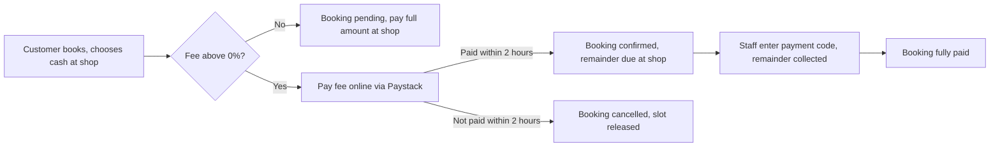

# Requirements: Booking fee for cash bookings

| Field | Value |
|-------|-------|
| Requested by | CTO |
| Date | 2026-11-22 |
| Status | Agreed (business rules); not started |
| Depends on | Paystack integration being live |

## 1. Business requirement (summary)
Customers who book a service and choose to pay cash at the shop currently pay nothing upfront, so a
no-show costs the provider the slot. Providers will be able to charge a **booking fee**: a percentage of
the booking price that the customer pays online when booking. The remainder is paid in cash at the shop.
Customers paying in-app already pay the full amount when booking, so the fee does not apply to them.

**Example:** R1 000 booking with a 20% fee → R200 paid online when booking, R800 paid in cash at the shop.

## 2. Stakeholders & user roles
| Role | Goal | Permissions |
|------|------|-------------|
| Provider (store owner) | Reduce no-shows on cash bookings | Sets the booking fee percentage for their business |
| Staff | Take the remaining cash payment | Enter the cash payment code; see the amount due |
| Customer | Book a slot and pay at the shop | Pays the fee online; may cancel |

## 3. Business process

## 4. Functional requirements
- **FR-1** A provider can set a booking fee percentage for their business, from 0% to 50%.
- **FR-2** When a customer books with cash at the shop and the fee is above 0%, the system takes the fee online via Paystack when the customer books.
- **FR-3** When the fee is 0%, cash bookings behave as they do today, with no online step.
- **FR-4** In-app bookings take the full amount when booking; the booking fee is not applied.
- **FR-5** A cash booking whose fee is not paid within 2 hours is cancelled and its slot released.
- **FR-6** The cash payment code confirms only the remainder. Staff see the amount due (e.g. "R800 due") with the code, and entering it marks the booking fully paid.
- **FR-7** Receipts and the Payments page show the booking fee (online), the amount paid at the shop (cash) and the total as separate lines. Refunds and fees the provider keeps are shown as their own lines.
- **FR-8** On cancellation, the system refunds the fee or keeps it for the provider according to BR-4 to BR-6.

## 5. Business rules
- **BR-1** Fee range is 0% to 50% of the booking price. 0% means no fee. *(CTO, 2026-11-22)*
- **BR-2** The fee applies only to cash-at-shop bookings. *(CTO)*
- **BR-3** An unpaid fee releases the slot after 2 hours, matching unpaid in-app orders (`app.orders.unpaid-expiry.in-app=PT2H`). *(CTO)*
- **BR-4** Customer cancels at least 24 hours before the booking start: fee refunded. *(CTO)*
- **BR-5** Customer cancels less than 24 hours before the start, or does not show up: the provider keeps the fee. *(CTO)*
- **BR-6** Provider cancels, at any time: fee always refunded. *(CTO)*
- **BR-7** The fee amount and percentage are fixed when the booking is made; later changes to the provider's percentage or the service price do not affect existing bookings. *(Proposed default, consistent with booking amounts being fixed at booking time.)*

## 6. Non-functional requirements
- **NFR-1** Money: amounts stored as exact decimals in ZAR; fee rounded to the nearest cent, with the remainder = price minus fee so the parts always add up to the total.
- **NFR-2** Security: refunds and fee outcomes are decided server-side only; a customer cannot change the fee or the remainder. Payment code checks keep the existing guessing protection (`CashCodeGuard`).
- **NFR-3** Audit: every fee payment, refund and forfeit is recorded with time, amount and the reason (customer cancellation, late cancellation, no-show, provider cancellation).
- **NFR-4** Reliability: Paystack payment and refund notifications are idempotent; a repeated notification never double-confirms or double-refunds.

## 7. User stories & acceptance criteria
### US-1 Provider sets a booking fee
*As a provider, I want to set a booking fee percentage, so that customers who book with cash commit to their slot.*
- **AC-1** Given I am a store owner, when I save a fee of 20%, then new cash bookings charge 20% online.
- **AC-2** (negative) Given I enter 60% or a negative value, when I save, then it is rejected with a message stating the allowed range is 0% to 50%.
- **AC-3** (authorization) Given a user without permission to change business settings, when they try to set the fee, then the request is refused (403).

### US-2 Customer pays the fee when booking with cash
*As a customer, I want to pay a small part upfront and the rest at the shop.*
- **AC-1** Given a R1 000 service and a 20% fee, when I book with cash at the shop, then I am asked to pay R200 online and shown that R800 is due at the shop.
- **AC-2** Given I do not pay the fee within 2 hours, then the booking is cancelled and the slot becomes available again.
- **AC-3** Given the fee is 0%, when I book with cash, then I am not asked to pay anything online.
- **AC-4** Given I choose in-app payment, then I pay the full R1 000 and no booking fee is shown.

### US-3 Staff collect the remainder
- **AC-1** Given a booking with the fee paid, when staff look up the booking, then they see "R800 due" and the payment code.
- **AC-2** When staff enter the correct code, then the booking is marked fully paid.

### US-4 Cancellations and refunds
- **AC-1** Given I cancel 25 hours before the start, then the R200 fee is refunded.
- **AC-2** Given I cancel 23 hours before the start, then the fee is not refunded and is recorded as kept by the provider.
- **AC-3** Given I do not show up, when the provider marks a no-show, then the fee is kept by the provider.
- **AC-4** Given the provider cancels 1 hour before the start, then the fee is refunded.

## 8. Edge cases
| # | Case | Expected behaviour |
|---|------|--------------------|
| 1 | Customer books less than 24 hours before the start | Booking is allowed; fee is non-refundable from the moment it is paid (BR-5). Show this to the customer before paying. |
| 2 | Cancellation exactly 24 hours before the start | Refunded ("at least 24 hours"). |
| 3 | Provider changes the percentage after a booking is made | Existing booking keeps its original fee (BR-7). |
| 4 | Paystack payment succeeds after the 2 hour window has cancelled the booking | Payment is refunded automatically; booking stays cancelled. |
| 5 | Paystack refund fails | Refund is retried and flagged for support; the customer sees "refund in progress". |
| 6 | Fee rounds to less than the Paystack minimum charge | To be decided at build time from Paystack's limits. |

## 9. Dependencies, assumptions, risks
- Dependency: Paystack integration live for charges and refunds.
- Assumption: refunds go back to the original payment method via Paystack.
- Dependency (if split payments are used): the platform commission percentage and who bears the Paystack fee must be decided, and refunds of split payments must be confirmed with Paystack.
- Dependency: a way for providers to mark a booking as a no-show (needed for BR-5). This does not exist today and must be built as part of this feature.
- Risk: customers may see a non-refundable fee as a barrier; the cancellation terms must be shown clearly before payment.

## 10. Open questions
| # | Question | Blocking? | Proposed default |
|---|----------|-----------|------------------|
| 1 | Paystack minimum charge for very small fees (edge case 6) | No | Skip the online step when the fee is below the minimum |
