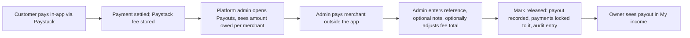

# Requirements: Provider payouts, platform commission and 7-day date defaults

| Field | Value |
|-------|-------|
| Requested by | CTO |
| Date | 2026-11-23 |
| Status | Agreed (business rules, CTO decisions 1-8); no blocking questions |
| Size | M |
| Depends on | Paystack integration live (`online_payment_attempts`, settlement service) |

## 1. Business requirement (summary)
In-app (Paystack) payments for merchant orders and salon bookings land in the **platform's** Paystack account, not the merchant's. Nothing in the app tells the platform admin what each merchant (provider/tenant) is owed, and owners cannot see their earnings (My income shows "No attributed work yet" for an owner without an employee record). Several date-filtered pages also open empty or unfiltered.

This feature gives the platform admin a page that shows what each merchant is owed and lets the admin record that the money was paid. The admin pays **outside the app** (Paystack dashboard or bank) and then clicks "Mark released". The app never moves money. It also adds a platform commission %, captures the Paystack fee, shows owners their earnings and payouts, and makes date-filtered pages default to the last 7 days.

**Resolves the dependency in `booking-fee.md`:** no Paystack split payments are used. The platform collects everything; the provider bears the Paystack fee; the platform commission is one fixed % (this document).

## 2. Stakeholders & user roles
| Role | Goal | Permissions |
|------|------|-------------|
| Platform admin | See what each merchant is owed, record releases, set the commission | Everything in this feature (Support/platform console) |
| Support staff (non-admin) | n/a | No access to payouts or the commission setting |
| Store owner (provider) | See earnings, what is still owed to them, payouts received | Read-only, own store only |
| Employee / staff | Existing My income | Unchanged; no payout data |

## 3. Business process

## 4. Functional requirements
- **FR-1** Date-filtered pages default to the last 7 days (today and the 6 days before): My income, Payment calculations (payroll), Insights and the Payout history page. The Payouts (owed) page has no date filter: it always shows every unreleased payable payment, so older money owed can never be hidden (chief-architect decision, money safety). The user can change or clear the dates. Promotion start/end dates are form fields and are excluded.
- **FR-2** The platform admin can set a platform commission % (platform settings). Allowed 0% to 50%, default 0%.
- **FR-3** For every new in-app order/booking payment, the system captures the Paystack transaction fee from Paystack when the payment is settled.
- **FR-4** A Payouts page (platform admin only) lists, per merchant, all payments owed, regardless of date: count, gross, Paystack fees, commission and net owed.
- **FR-5** A release screen per merchant shows the covered payments, the merchant's bank details (bank name, account holder, account number, branch code) from shop settings, an editable fee total (prefilled with the known fees), a required payment reference and an optional note. "Mark released" records the payout.
- **FR-6** A payout stores exactly which payments it covers and snapshots the commission % used, the fees, the commission, the net amount, reference, note, releasing admin and time.
- **FR-7** A Payout history page lists released payouts with a date filter and a merchant filter, and shows the payments each payout covers.
- **FR-8** Every release, and every commission change, is audit-logged.
- **FR-9** My income for store owners shows store earnings and payouts (see US-7). Employees keep the existing view.
- **FR-10** The test-database reset clears payout data and keeps the commission setting.

## 5. Business rules
- **BR-1** Payable = a settled in-app payment for a merchant **order or salon booking**, not yet in a payout. Merchant subscription payments are platform revenue and never payable. *(CTO 5)*
- **BR-2** A payment that was refunded, needs a refund (`NEEDS_REFUND`), is a duplicate (`DUPLICATE`), or whose order/booking is cancelled is never payable. *(CTO 5; cancelled rule is assumption A5)*
- **BR-3** Net owed = gross - Paystack fees - commission. Fee is borne by the provider. *(CTO 4)*
- **BR-4** Commission = commission % x gross payment amount, rounded half-up to the cent per payment. The % used is snapshotted on the payout; later changes never alter released payouts. *(CTO 3; base confirmed by CTO 2026-11-23: gross)*
- **BR-5** A payment's fee is unknown for payments made before fee capture (or if Paystack returned none). Unknown counts as R0 in the prefilled fee total and is flagged. At release the admin may replace the **fee total** for the whole payout with any value >= 0 (the commission is unaffected). The payout stores both the captured fees and the adjusted fee total used. *(CTO 4)*
- **BR-6** A payment can be in at most one payout, even under concurrent releases. *(CTO 5)*
- **BR-7** A release is recorded only; the app never calls the Paystack Transfers API. *(CTO 2)*
- **BR-8** Only the platform admin can see or change anything on payouts and the commission. Owners see only their own store. *(CTO 7, 8)*

## 6. Non-functional requirements
- **NFR-1** Money: ZAR, exact (integer cents / decimals, no floating point); net = gross - fees - commission always adds up exactly.
- **NFR-2** Integrity: a database-level guarantee (unique payment-in-payout) enforces BR-6; release is atomic (all covered payments or none); a repeated click or retried request creates one payout.
- **NFR-3** Security/privacy: bank details are shown only to the platform admin on the release screen and are never written to logs or audit entries. Authorization is enforced server-side.
- **NFR-4** Audit: audit entries hold actor, time, merchant, payout id, amounts, reference and whether the fee was adjusted.
- **NFR-5** Performance (proposed): Payouts page for a 7-day range loads in under 2 s (p95) at up to 500 merchants / 10 000 payments.
- **NFR-6** Retention: payouts and their payment links are never deleted by the app except by the test-database reset.

## 7. User stories & acceptance criteria
### US-1 Dates default to the last 7 days
*As a user of a date-filtered page, I want the last 7 days preloaded, so that the page is populated when I open it.*
- **AC-1** Given today is 2026-11-23, when I open My income, Payment calculations, Insights or Payout history, then the range is 2026-11-17 to 2026-11-23 inclusive and the data for that range is loaded and shown (My income is populated, not blank).
- **AC-2** Given I change or clear the dates, then the page uses my choice (cleared = no date limit) and does not snap back to 7 days until I reopen the page; Promotion start/end fields are unchanged.

### US-2 Platform admin sets the commission
*As a platform admin, I want to set the platform commission, so that the platform earns on in-app payments.*
- **AC-3** Given I am a platform admin, when I save 12.5%, then it is stored, applied to payouts released afterwards, an audit entry is written, and previously released payouts keep their snapshot %.
- **AC-4** (negative) Given I enter 51, -1 or a non-number, when I save, then it is rejected with "Commission must be between 0% and 50%" and the stored value is unchanged.
- **AC-5** (authorization) Given a support-staff, merchant or unauthenticated user, when they call any payout or commission endpoint, then the response is 403 (401 if unauthenticated) and no data is returned.

### US-3 Paystack fee captured
- **AC-6** Given a new Paystack payment for an order or booking is settled, then its Paystack fee is stored once with the payment (a repeated webhook/verify does not change it); if Paystack supplies no fee it is stored as unknown and shown as "fee unknown", never as R0 silently.

### US-4 Admin sees what each merchant is owed
*As a platform admin, I want to see per merchant what I owe, so that I know how much to pay out.*
- **AC-7** Given a merchant has one settled R1 000 booking payment with a known fee of R25 and commission is 10%, when I open Payouts, then that merchant shows gross R1 000.00, fees R25.00, commission R100.00, net owed R875.00, 1 payment.
- **AC-8** (negative) Given payments that are subscription payments, `NEEDS_REFUND`/`DUPLICATE`, for cancelled orders/bookings, or already in a payout, then they are not counted; a merchant with nothing owed is not listed.

### US-5 Admin releases funds
*As a platform admin, I want to record that I paid a merchant, so that the same money is never paid twice.*
- **AC-9** Given I open a merchant's release screen, then I see the bank details from shop settings; if any of the four fields is empty I see a warning naming the missing fields, and I can still release.
- **AC-10** Given the fee total is prefilled with the known fees, when I change it to R30 and release, then net = gross - R30 - commission, and the payout stores captured fees and adjusted fees. (Negative) A fee total below 0 or resulting in a net <= 0 is rejected with a message and nothing is recorded.
- **AC-11** (negative) Given the reference is blank (or only spaces), when I click "Mark released", then it is rejected ("Payment reference is required") and no payout is created.
- **AC-12** Given a valid release, when I click "Mark released", then one payout is created holding the covered payments, commission % snapshot, fees, commission, net, reference, note, my identity and time; those payments no longer appear as owed; no money movement is attempted.
- **AC-13** Given two admins (or a double-click) release the same merchant's payments at the same moment, then exactly one payout is created, the other receives "These payments have already been released" and no payment is in two payouts.
- **AC-14** (negative) Given a payment was added or became non-payable (e.g. flagged for refund) after I opened the screen, when I click "Mark released", then it is rejected with "Amounts have changed, please refresh", and nothing is recorded.
- **AC-15** Given a release succeeds, then an audit entry (actor, time, merchant, payout id, net amount, reference, fee adjusted yes/no) exists and contains no bank account number.

### US-6 Payout history
- **AC-16** Given I open Payout history, then released payouts for the last 7 days are listed (date, merchant, gross, fees, commission %, commission, net, reference, released by); I can filter by merchant and dates, and open a payout to see its payments.

### US-7 Store owner sees earnings and payouts
*As a store owner, I want to see what I earned and what I am owed, so that I can reconcile with the platform.*
- **AC-17** Given I am an owner with no employee record, when I open My income, then instead of "No attributed work yet" I see for the range: my store's paid orders/bookings (with totals), the amount the platform still owes me from in-app payments (all unreleased payments regardless of the range; same calculation as the Payouts page, at the current commission %), and my released payouts (date, net amount, commission, fees, reference).
- **AC-18** (authorization) Given I am an owner, then I see only my own store's data and never the admin's internal payout note or other merchants' data.
- **AC-19** Given I am an employee/staff member, when I open My income, then the existing view is shown unchanged with no payout or commission data.

### US-8 Test-database reset
- **AC-20** Given the platform admin resets the test database, then all payouts and their payment links are removed, and the commission setting is kept.

## 8. Edge cases
| # | Case | Expected behaviour |
|---|------|--------------------|
| 1 | Merchant has a payment dated just before midnight SAST | Falls in the range by its South African calendar date (A1). |
| 2 | All of a merchant's payments have unknown fees | Fee total prefilled R0; row flagged "fee unknown"; admin may enter the real total. |
| 3 | Payments older than the 7-day window are unreleased | They are always included in the owed amount and in the release (Payouts has no date filter). |
| 4 | Commission changed between viewing and releasing | Release uses the % current at release time and the screen shows the updated amounts; if amounts differ from what was on screen, AC-14 applies. |
| 5 | Commission is 0% | No commission line; net = gross - fees. |
| 6 | Payment refunded after it was paid out | Out of scope: see follow-ups; the payout is not altered. |

## 9. Dependencies, assumptions, risks
- Dependency: Paystack's verify/webhook response includes the transaction fee (to be confirmed at build time).
- Dependency: `booking-fee.md` cash booking fees (when built) are also online booking payments; whether they are payable is a follow-up, not covered here.
- **A1** "Date" of a payment = time it was settled (outcome time), in South Africa time (SAST); "last 7 days" uses the same zone.
- **A2** Fee capture applies to new payments only; no back-fill of older payments (admin adjusts at release, BR-5).
- **A3** The payment reference is not required to be unique (one bank transfer may cover several merchants); free text, max 100 chars; note max 500 chars.
- **A4** A release covers exactly all currently owed payments of the selected merchant (not a hand-picked subset, no date window). *(Revised by chief-architect: a date window could hide money owed.)*
- **A5** A payment whose order/booking has been cancelled is treated as needing a refund and is not payable.
- **A6** An owner who also has an employee record sees the new store section in addition to the existing employee section.
- Risk (resolved): a date window on the owed list could hide older unreleased payments, so the owed list and release are not date-limited.
- Risk: an admin may enter a wrong fee total; mitigated by the audit trail and by storing captured vs adjusted fees.

## 10. Open questions
| # | Question | Blocking? | Proposed default |
|---|----------|-----------|------------------|
| 1 | Is commission % taken from the gross payment (R1 000 x 10% = R100) or from gross minus the Paystack fee? | Resolved | CTO 2026-11-23: gross payment amount, rounded half-up to the cent per payment |
| 2 | Should release be blocked when bank details are missing? | No | Warn only (AC-9), because the admin may hold details elsewhere |
| 3 | Should the owner see the admin's note? | No | No, internal only (AC-18) |

**Follow-ups (not in scope):** clawback when a paid-out payment is later refunded; including booking-fee payments; bank-detail snapshot on the payout; CSV export; "older unreleased" banner; bulk release across merchants; Paystack Transfers API automation; payout notification to the owner.
